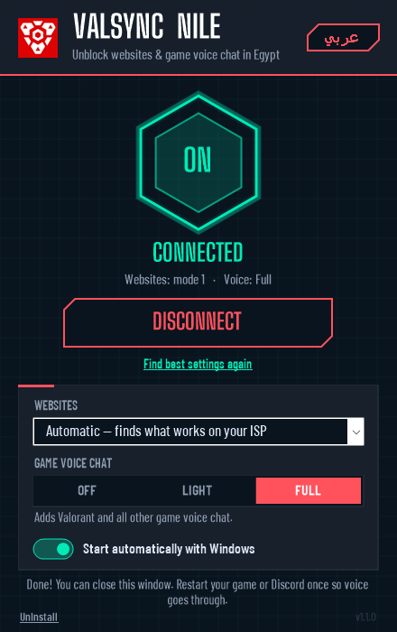

# VALSYNC Nile

VALSYNC Nile unblocks websites and game voice chat on Egyptian ISPs: WE (TE Data), Vodafone, Orange and Etisalat/e&. It's a one-file Windows app built on two open-source engines that run side by side:

- **Websites (TCP):** the [GoodbyeDPI](https://github.com/ValdikSS/GoodbyeDPI) 0.2.2 engine. Egyptian ISPs block sites by reading the domain name (SNI) in the TLS handshake and by tampering with DNS answers. GoodbyeDPI splits the TLS ClientHello and sends fake packets so the DPI box can't read the domain. DNS goes to Yandex on port 1253, a non-standard port the ISP doesn't intercept.
- **Voice chat in games and calls (UDP):** the [zapret](https://github.com/bol-van/zapret) `winws` v72.13 engine. It covers Valorant/Vivox, Discord voice, WhatsApp and Telegram calls (STUN), and other UDP voice. GoodbyeDPI can't handle UDP, so voice needs this separate process. It only touches UDP, and GoodbyeDPI only touches TCP and DNS, so the two never handle the same packets. Voice needs 64-bit Windows.

This is **not a VPN**. Your IP isn't hidden, and traffic isn't encrypted beyond normal HTTPS. Sites and voice servers that are blocked by IP address, or traffic that is only throttled, won't be fixed by this.

## Setup (Windows 7/8/10/11)

1. Download **`VALSYNC-Nile.exe`** from the [latest release](https://github.com/AbdullahElTiby/ValSync-Nile/releases/latest).
2. Double-click it and press **Yes** on the administrator prompt. If Windows SmartScreen shows "Windows protected your PC", click **More info → Run anyway**. The app isn't code-signed yet.
3. Press **CONNECT**. In **Automatic** mode, the app tries each website mode against sites that are blocked in Egypt and keeps the first one that opens them. This takes up to a minute the first time.
4. Pick a **Game voice chat** level. **Full** covers Valorant; **Light** covers Discord voice and WhatsApp/Telegram calls. Then restart your game or Discord once.
5. Close the window. **VALSYNC Nile keeps working without it.** The app only sets up two Windows services (`ValSync` and `ValSync-Voice`). With **Start automatically with Windows** on, they come back after every restart.

To change settings, open the app again. To remove everything, open it and click **Uninstall**. The app needs .NET Framework 4.5 or newer, which is built into Windows 10 and 11.

## Advanced: batch scripts

The repository also has the original batch scripts, for people who prefer them. Download the source zip, extract it somewhere permanent, and follow these steps.

1. Right-click `valsync_nile.cmd` → **Run as administrator**.
2. **Websites:** choose `1` and open a blocked site in a new tab. If it doesn't load, close the VALSYNC Nile window and try 2 → 3 → 4 → 5.
3. **Voice:** choose `V1`, then fully restart the game or Discord. If voice still fails, close the "VALSYNC Nile Voice" window and try `V2`.
4. Once both work, run `service_install.cmd` as administrator to install them as services that start with Windows.
| File | What it does |
|---|---|
| `valsync_nile.cmd` | Menu: try website and voice profiles, install or remove services |
| `quick_start.cmd` | One-click start with website profile 1 |
| `service_install.cmd` | Installs the `ValSync` and (optional) `ValSync-Voice` services |
| `service_remove.cmd` | Removes both services and the WinDivert drivers |
| `profiles.cmd` | Website profile flags. Edit this file to tune a profile. |
| `voice_profiles.cmd` | Voice profile flags |
| `egypt-blacklist.txt` | Domains used by website profile 6. Add one domain per line. |
| `voice\` | zapret `winws.exe` and its WinDivert 2.2 driver |
| `gui\` | Source and build script for `VALSYNC-Nile.exe` (`powershell -File gui\build.ps1`) |

### Website profiles

| # | Flags | When to use |
|---|---|---|
| 1 | `-9` + DNS | Default, works on most ISPs |
| 2 | `-5 --set-ttl 5` + DNS | The Turkey default; try it if 1 fails |
| 3 | `-9 --frag-by-sni --fake-gen 5 --fake-resend 2` + DNS | Stricter DPI |
| 4 | `-5 --set-ttl 3 -q`, no DNS redirect | You already use DoH or a custom DNS |
| 5 | `-1 -q` + DNS | Old routers or VMs where fake packets break things |
| 6 | `-9 --frag-by-sni` + DNS + `--blacklist` | Only touches listed sites; other traffic is left alone |

### Voice profiles

| # | What it covers | Cost |
|---|---|---|
| V1 | Discord voice and STUN-based calls (WhatsApp, Telegram, many game voice SDKs) | Very light: the driver only picks up matching packets |
| V2 | Everything in V1, plus Vivox (Valorant, League of Legends, many others), any UDP voice on ports 12000-65535, and WireGuard VPN handshakes | Fake packets go out only at the start of each flow. Valorant's game traffic (ports 7000-8000) isn't touched. |

If V2 adds lag or breaks another game, go back to V1.

### Troubleshooting

- **Websites still blocked:** run `ipconfig /flushdns`, restart the browser, and turn off QUIC at `chrome://flags/#enable-quic` (in Firefox: `about:config` → `network.http.http3.enable`).
- **Voice still silent:** restart the game or Discord *after* starting voice bypass, because existing voice sessions don't reconnect by themselves. In Discord, try a different voice region. If neither V1 nor V2 helps, your ISP is probably blocking the voice server's IP, and only a VPN will fix that.
- **"VALSYNC Nile couldn't start" / antivirus deletes `WinDivert64.sys` or `winws.exe`:** these are false positives on the packet driver. Add `VALSYNC-Nile.exe` and `C:\ProgramData\ValSync-Nile` as exclusions, then press Connect again.
- **Some sites break:** use website profile 6 so only the listed domains get the bypass.
- **Uninstall:** open VALSYNC Nile and click **Uninstall** (or run `service_remove.cmd` as administrator).

---

## بالعربي

أداة جاهزة لتخطي الحجب على شبكات WE وفودافون وأورنج واتصالات في مصر. بتفتح المواقع المحجوبة، وبتشغّل الفويس شات في الألعاب (فالورانت، ديسكورد، مكالمات واتساب وتليجرام).

1. نزّل **`VALSYNC-Nile.exe`** من [آخر إصدار](https://github.com/AbdullahElTiby/ValSync-Nile/releases/latest).
2. افتحه واضغط **Yes** على رسالة صلاحيات المسؤول. لو ظهرت رسالة "Windows protected your PC" اضغط **More info ← Run anyway**.
3. اضغط **اتصال**. الوضع التلقائي بيجرّب كل الأوضاع على مواقع محجوبة في مصر ويختار اللي بيفتحها (ممكن ياخد دقيقة أول مرة).
4. اختار مستوى **صوت الألعاب**: **كامل** لفالورانت، و**خفيف** لديسكورد ومكالمات واتساب وتليجرام. وبعدين اقفل اللعبة أو ديسكورد وافتحهم تاني مرة واحدة.
5. اقفل النافذة. **البرنامج هيفضل شغال من غيرها**، ولو "التشغيل تلقائياً مع الويندوز" متفعّل هيشتغل لوحده بعد كل ريستارت.
6. لإزالته: افتح البرنامج واضغط **إزالة**.
الأداة دي **مش VPN**. مش بتخفي الـ IP بتاعك، والمواقع أو سيرفرات الصوت المحجوبة بالـ IP مش هتشتغل بيها.

## Credits & license

- GoodbyeDPI by [ValdikSS](https://github.com/ValdikSS/GoodbyeDPI), Apache-2.0. Binaries are unmodified from the official 0.2.2 release.
- zapret by [bol-van](https://github.com/bol-van/zapret), MIT. `winws.exe`, `cygwin1.dll` (LGPLv3) and WinDivert are unmodified from the official v72.13 release. Their SHA-256 hashes match the release's `sha256sum.txt`, and `WinDivert64.sys` matches the official WinDivert 2.2.2 release.
- WinDivert by basil00, LGPLv3. See `licenses/` and `voice/licenses/`.
- Fonts: Big Shoulders Display and Barlow Condensed, SIL Open Font License 1.1. The VALSYNC logo is a VALSYNC brand asset.
- The preset approach is inspired by [cagritaskn/GoodbyeDPI-Turkey](https://github.com/cagritaskn/GoodbyeDPI-Turkey).
